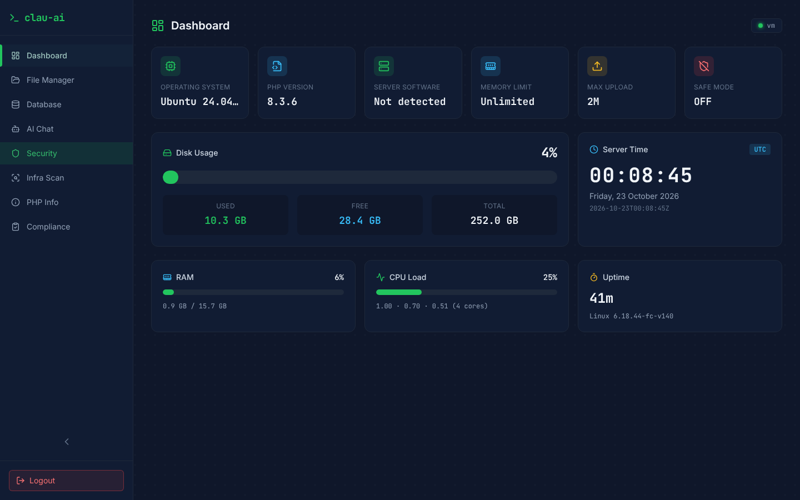
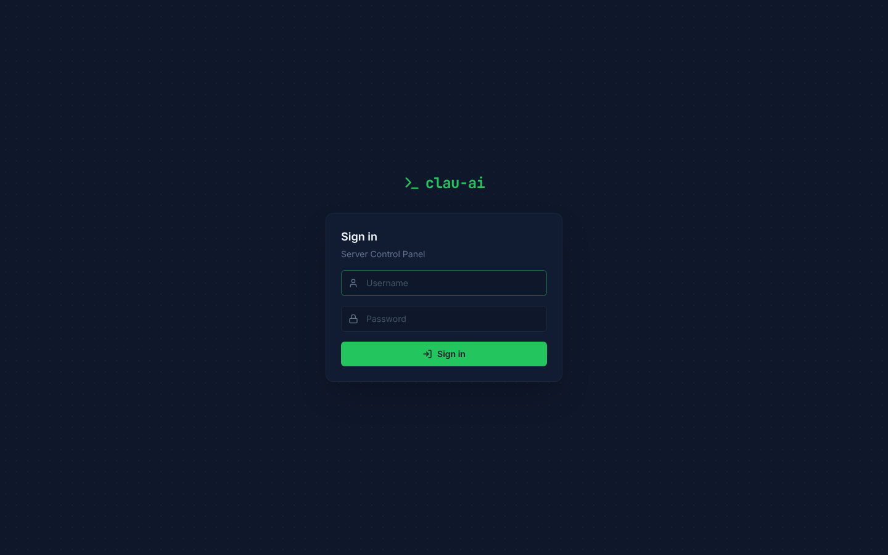
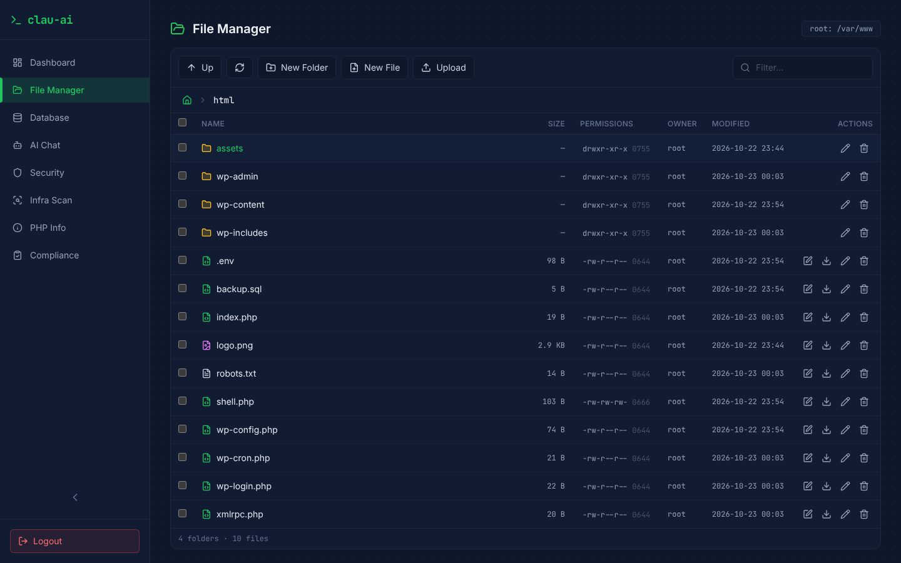
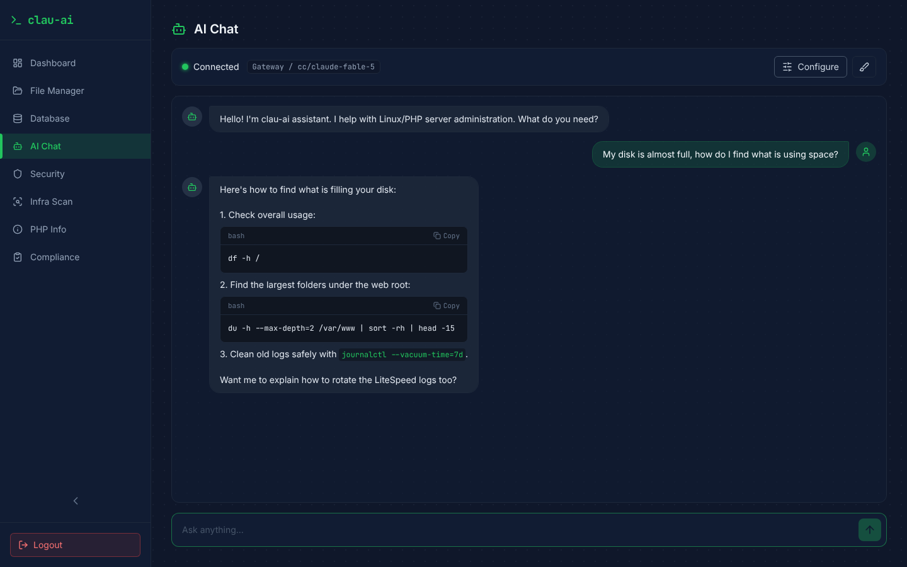
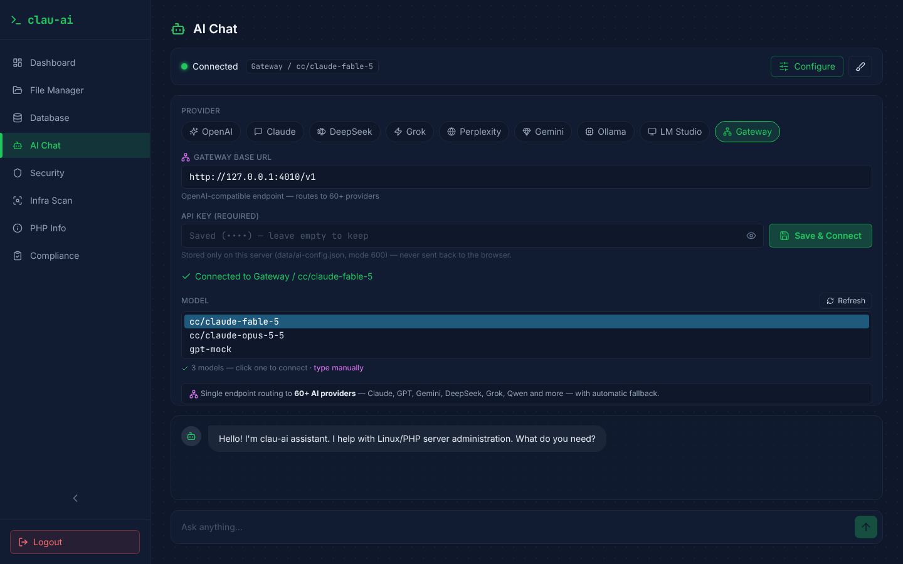
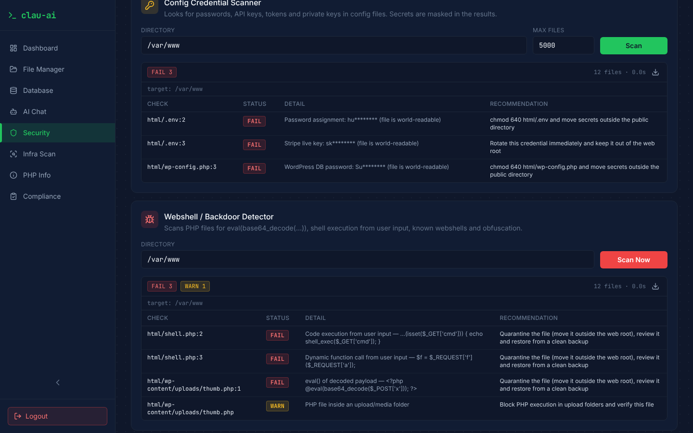
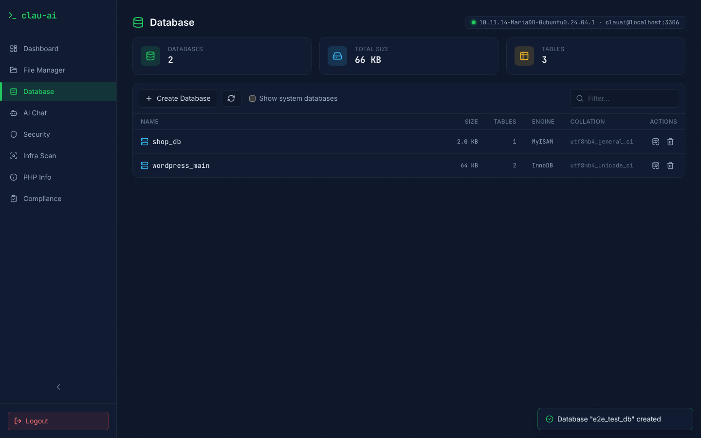
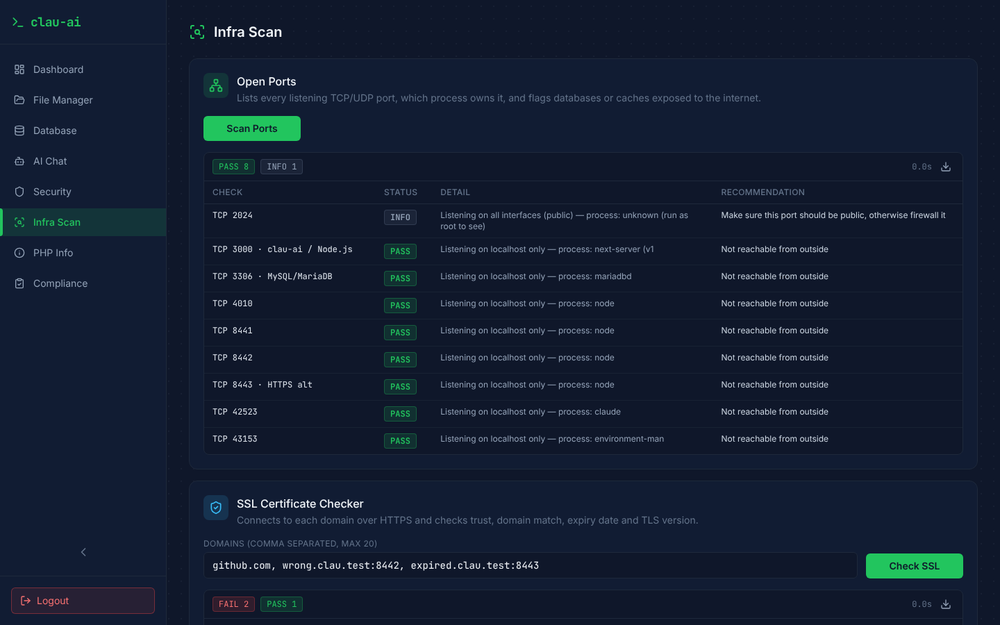
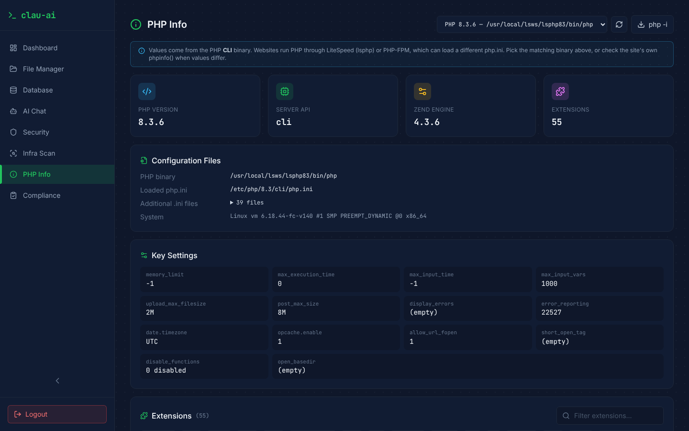

# clau-ai

**Web Server Control Panel modern dengan AI Assistant.** Pantau server, kelola file dan database,
audit keamanan, dan tanya AI soal Linux/PHP dari satu dashboard bertema gelap.



---

## Daftar Isi

- [Fitur Utama](#fitur-utama)
- [Screenshot](#screenshot)
- [Tech Stack](#tech-stack)
- [Prasyarat](#prasyarat)
- [Instalasi di VPS (1 perintah)](#instalasi-di-vps-1-perintah)
- [Development](#development)
- [Konfigurasi](#konfigurasi)
- [Keamanan](#keamanan)
- [API](#api)
- [Struktur Folder](#struktur-folder)
- [Lisensi](#lisensi)

## Fitur Utama

| Modul | Yang bisa dilakukan |
|---|---|
| **Dashboard** | OS, versi PHP, `memory_limit`, `upload_max_filesize`, Safe Mode, web server (LiteSpeed/Nginx/Apache/Caddy), Disk, RAM, CPU load, uptime, jam server (UTC). Data live, refresh otomatis tiap 30 detik. |
| **File Manager** | Jelajah folder, buat file/folder, editor teks (Ctrl+S), upload drag & drop dengan progress, download, rename, chmod, hapus massal, filter. |
| **Database** | Daftar database MySQL/MariaDB (ukuran, jumlah tabel, engine, collation), buat database, backup `.sql.gz` (mysqldump), hapus dengan konfirmasi nama. |
| **AI Chat** | Asisten sysadmin dengan 9 provider: OpenAI, Claude, DeepSeek, Grok, Perplexity, Gemini, Ollama, LM Studio, dan Gateway (endpoint OpenAI-compatible). Daftar model otomatis, blok kode dengan tombol Copy. |
| **Security Scanner** | Permission Auditor, Config Credential Scanner (secret disamarkan), Webshell/Backdoor Detector, PHP.INI Security Auditor. Hasil PASS / FAIL / WARN + rekomendasi, bisa diekspor ke JSON. |
| **Infra Scan** | Port yang terbuka (+ deteksi MySQL/Redis/MongoDB dll. yang terekspos publik), pemeriksa sertifikat SSL (kedaluwarsa, salah domain, chain, versi TLS), status layanan & unit systemd yang gagal, update keamanan yang tertunda, proses teratas. |
| **PHP Info** | Deteksi otomatis semua versi PHP (php8.x, LiteSpeed lsphp, cPanel ea-php, CloudLinux alt-php, Plesk), versi & SAPI, php.ini yang dimuat, setting penting, daftar extension, tabel semua INI directive dengan filter, unduh `php -i`. |
| **Compliance** | 15 pemeriksaan hardening server yang dipetakan ke kontrol **SOC 2** dan **ISO 27001:2022 Annex A** (SSH root login, firewall, fail2ban, auto-update, NTP, auditd, dll). |
| **Login** | Satu akun admin, password di-hash scrypt, sesi JWT (cookie `httpOnly`, `SameSite=Strict`), batas percobaan login. |

## Screenshot

| | |
|---|---|
|  |  |
| **Login** | **File Manager** |
|  |  |
| **AI Chat** | **Konfigurasi provider AI** |
|  |  |
| **Security Scanner** | **Database** |
|  |  |
| **Infra Scan** | **PHP Info** |

## Tech Stack

- **[Next.js 14](https://nextjs.org/)** (App Router): frontend dan backend (API routes) dalam satu aplikasi
- **[React 18](https://react.dev/)** + **TypeScript**
- **[Tailwind CSS](https://tailwindcss.com/)**: tema gelap
- **[Lucide](https://lucide.dev/)**: ikon
- **Node.js**: akses sistem (`fs`, `child_process.execFile`)
- **[jose](https://github.com/panva/jose)**: JWT · **[mysql2](https://github.com/sidorares/node-mysql2)**: MySQL/MariaDB
- **[@anthropic-ai/sdk](https://github.com/anthropics/anthropic-sdk-typescript)**: provider Claude

> Backend memakai **Next.js API routes**, bukan server Express terpisah. Hasilnya satu proses, satu port,
> dan satu konfigurasi deploy, sementara endpoint dan middleware JWT-nya tetap ada (lihat [API](#api)).

## Prasyarat

- VPS **Ubuntu 22.04/24.04, Debian 12, AlmaLinux/Rocky 9** (akses root/sudo). RAM 1 GB cukup; installer menambah swap bila perlu.
- Installer memasang sendiri **Node.js 22 LTS**, Git dan Nginx bila belum ada.
- Opsional: **PHP** (info & audit PHP), **MySQL/MariaDB** (halaman Database), **domain** yang mengarah ke IP VPS (untuk HTTPS).

## Instalasi di VPS (1 perintah)

```bash
git clone https://github.com/d34faiza-commits/clau-ai.git
cd clau-ai
sudo bash scripts/install.sh
```

Installer menanyakan domain, email (untuk HTTPS), folder website, dan password admin, lalu otomatis:

1. Memasang Node.js 22, Git, Nginx (dan swap 2 GB bila RAM kecil)
2. Membuat user Linux khusus `clauai` (panel **tidak** berjalan sebagai root)
3. Menyalin aplikasi ke `/opt/clau-ai`, membuat `.env` (mode 600) dengan akun admin & `AUTH_SECRET`
4. Mendeteksi PHP yang dipakai website (LiteSpeed lsphp, cPanel ea-php, atau php sistem)
5. Membuat user MySQL `clauai` untuk halaman Database (jika MySQL/MariaDB berjalan)
6. Build, lalu menjalankan sebagai service **systemd** (atau PM2 bila tanpa systemd)
7. Mengonfigurasi **Nginx** + sertifikat **Let's Encrypt** (HTTPS) dan membuka port di UFW/firewalld bila aktif
8. Mencetak alamat panel, username dan password

Tanpa domain, panel dibuka di `http://IP-SERVER:8090`. Jika server sudah memakai **LiteSpeed/CyberPanel** atau **Apache**,
Nginx dilewati dan installer menampilkan langkah reverse-proxy untuk web server tersebut.

**Tanpa tanya-jawab** (semua jawaban lewat variabel):

```bash
sudo DOMAIN=panel.domainanda.com EMAIL=anda@email.com ASSUME_YES=1 bash scripts/install.sh
```

| Variabel | Default | Keterangan |
|---|---|---|
| `DOMAIN` / `EMAIL` | – | Domain panel & email Let's Encrypt (keduanya diisi → HTTPS otomatis) |
| `WEB_ROOT` | `/var/www` | Folder untuk File Manager & Security Scanner |
| `APP_USER` | pemilik `WEB_ROOT` atau `clauai` | User Linux yang menjalankan panel |
| `ADMIN_USER` / `ADMIN_PASS` | `admin` / dibuat acak | Login panel |
| `INSTALL_DIR` | `/opt/clau-ai` | Lokasi aplikasi |
| `PORT` / `PANEL_PORT` | `3000` / `8090` | Port internal Node.js / port publik bila tanpa domain |
| `SETUP_NGINX` / `SETUP_DB` | `auto` | `yes` / `no` untuk memaksa atau melewati langkah tsb. |
| `RESET_ADMIN` | `0` | `1` = ganti login admin saat installer dijalankan ulang |

Installer aman dijalankan ulang: login admin, user database dan pengaturan yang sudah ada dipertahankan.

> Repo privat? `git clone` akan meminta username GitHub dan **Personal Access Token** (bukan password).
> Buat token di GitHub → Settings → Developer settings → Personal access tokens (scope: `repo`, read-only cukup).

### Update, uninstall & perintah harian

```bash
sudo bash /opt/clau-ai/scripts/update.sh      # tarik versi terbaru, build, restart (rollback otomatis bila gagal)
sudo bash /opt/clau-ai/scripts/uninstall.sh   # hapus service & situs Nginx (website & database tidak disentuh)

systemctl status clau-ai                      # status
journalctl -u clau-ai -f                      # log
cd /opt/clau-ai && sudo -u clauai node scripts/setup.mjs && sudo systemctl restart clau-ai   # ganti password admin
```

### Instalasi manual (tanpa installer)

<details>
<summary>Langkah manual</summary>

```bash
# 1. Node.js 22 + Nginx + Git (Ubuntu/Debian)
curl -fsSL https://deb.nodesource.com/setup_22.x | sudo -E bash -
sudo apt install -y nodejs nginx git

# 2. Kode, akun admin, build (sebagai user pemilik website, bukan root)
sudo git clone https://github.com/d34faiza-commits/clau-ai.git /opt/clau-ai
sudo chown -R $USER:$USER /opt/clau-ai && cd /opt/clau-ai
npm ci && npm run setup
nano .env                       # FILE_MANAGER_ROOT, PHP_BINARY, DB_*
npm run build

# 3. Service: systemd (deploy/clau-ai.service) atau PM2
sudo npm install -g pm2 && pm2 start ecosystem.config.js && pm2 save && pm2 startup

# 4. Nginx + HTTPS
sudo cp deploy/nginx-clau-ai.conf /etc/nginx/sites-available/clau-ai   # ganti panel.example.com
sudo ln -s /etc/nginx/sites-available/clau-ai /etc/nginx/sites-enabled/
sudo nginx -t && sudo systemctl reload nginx
sudo apt install -y certbot python3-certbot-nginx && sudo certbot --nginx -d panel.domainanda.com

# 5. (Opsional) user database untuk panel
sudo mysql -e "CREATE USER 'clauai'@'localhost' IDENTIFIED BY 'password-kuat';
GRANT ALL PRIVILEGES ON *.* TO 'clauai'@'localhost'; FLUSH PRIVILEGES;"
```

</details>

## Development

```bash
npm install
npm run setup        # buat akun admin + AUTH_SECRET di .env
npm run dev          # http://localhost:3000
```

`npm run lint`, `npm run typecheck`, `npm run build`. CI (GitHub Actions) menjalankan semuanya, plus shellcheck untuk script installer, di setiap push dan pull request.

## Konfigurasi

Semua konfigurasi ada di `/opt/clau-ai/.env` (dibuat installer; manual: salin `.env.example`). Restart panel setelah mengubahnya.

| Variabel | Default | Keterangan |
|---|---|---|
| `AUTH_SECRET` | dibuat installer / `npm run setup` | Kunci tanda tangan JWT (min. 32 karakter) |
| `ADMIN_USERNAME` | dibuat installer / `npm run setup` | Username admin |
| `ADMIN_PASSWORD_HASH` | dibuat installer / `npm run setup` | Hash scrypt password admin |
| `FILE_MANAGER_ROOT` | `/var/www` (atau home user) | Folder yang boleh diakses File Manager & Security Scanner |
| `MAX_UPLOAD_MB` | `100` | Batas per file upload (samakan dengan `client_max_body_size` Nginx) |
| `PHP_BINARY` | `php` | PHP CLI, mis. `/usr/local/lsws/lsphp83/bin/php` untuk LiteSpeed |
| `DISK_PATH` | `/` | Mount point untuk kartu Disk Usage |
| `DB_HOST` / `DB_PORT` | `localhost` / `3306` | Server MySQL/MariaDB |
| `DB_USER` / `DB_PASSWORD` | – | Akun database untuk panel |
| `DB_SOCKET` | – | Pakai unix socket alih-alih host/port |
| `DATA_DIR` | `./data` | Lokasi penyimpanan konfigurasi AI |

## Keamanan

Control panel adalah target bernilai tinggi. Ini yang dilakukan clau-ai:

**Autentikasi & sesi**
- Semua halaman dan API (kecuali `/login`) diperiksa `middleware.ts`. Tanpa sesi valid, API mengembalikan
  `401` dan halaman dialihkan ke login.
- Password di-hash dengan **scrypt** (salt acak) dan dibandingkan dengan `timingSafeEqual`.
- Sesi berupa **JWT HS256** (12 jam) di cookie `httpOnly` + `SameSite=Strict` (+ `Secure` di HTTPS).
- Login dibatasi **5 percobaan gagal per IP per 15 menit**.
- Setiap request yang mengubah data wajib berasal dari origin yang sama (**anti-CSRF**).

**Cara endpoint yang menjalankan perintah shell diamankan**

Endpoint seperti info sistem, audit PHP dan backup database perlu menjalankan program. Aturan yang dipakai:

1. **Tidak pernah lewat shell.** Selalu `execFile` / `spawn` dengan **array argumen**, bukan `exec("cmd " + input)`.
   Karakter seperti `;`, `|`, `$()` dan backtick tidak punya arti khusus, jadi command injection tidak mungkin terjadi.
2. **Binary dan argumen tetap.** Hanya program yang sudah ditentukan (`ps`, `ss`, `apt`, `systemctl`, `php -r <script tetap>`,
   `mysqldump`). Input user tidak pernah menjadi nama perintah. Pilihan versi PHP hanya boleh salah satu binary hasil
   deteksi server, tidak bisa path bebas.
3. **Validasi ketat sebelum dipakai.** Nama database harus cocok `^[A-Za-z0-9_]{1,64}$` dan diletakkan setelah `--`.
   Path di-`realpath` lalu harus berada di dalam `FILE_MANAGER_ROOT`, sehingga `../` dan symlink ke luar ditolak.
4. **Rahasia tidak lewat argv.** Password database dikirim lewat env `MYSQL_PWD`, karena argumen proses bisa dilihat siapa saja lewat `ps`.
5. **Timeout & batas output.** Setiap perintah punya `timeout` dan `maxBuffer`, dan pemindai dibatasi jumlah file.
6. **Hak minimum.** Jalankan panel sebagai user biasa (pemilik website), bukan root. Kalaupun ada celah,
   kerusakannya terbatas pada hak user tersebut. Tidak ada endpoint "jalankan perintah bebas".
7. **Di balik autentikasi.** Semua endpoint berada di belakang middleware JWT dan tidak membuka port publik (bind `127.0.0.1`).

**Data sensitif**
- API key AI disimpan di `data/ai-config.json` (mode `600`) dan **tidak pernah dikirim balik ke browser**.
- Credential Scanner hanya menampilkan 2 karakter pertama dari setiap secret.
- `.env` dibuat dengan mode `600` oleh `npm run setup`.

## API

Semua endpoint membutuhkan cookie sesi (login lewat `POST /api/auth/login`).

| Method | Endpoint | Keterangan |
|---|---|---|
| `POST` | `/api/auth/login` | `{ username, password }` → set cookie sesi |
| `POST` | `/api/auth/logout` | Hapus sesi |
| `GET` | `/api/system` | Info server: OS, PHP, web server, disk, RAM, CPU, uptime |
| `GET` | `/api/files?path=/dir` | Isi folder |
| `POST` | `/api/files` | `{ action: mkdir \| touch \| rename \| delete \| chmod, ... }` |
| `GET` / `PUT` | `/api/files/content` | Baca / simpan file teks |
| `POST` | `/api/files/upload` | Multipart: `path`, `files[]`, `overwrite` |
| `GET` | `/api/files/download?path=` | Download file |
| `POST` | `/api/security/permissions` | `{ dir }` |
| `POST` | `/api/security/credentials` | `{ dir, maxFiles }` |
| `POST` | `/api/security/webshell` | `{ dir }`: cari `eval(base64_decode`, `system(`, `shell_exec(` dll. |
| `POST` | `/api/security/phpini` | Audit konfigurasi PHP |
| `POST` | `/api/security/compliance` | `{ framework: both \| soc2 \| iso27001 }` |
| `POST` | `/api/infra/ports` · `services` · `updates` · `processes` | Pemindaian infrastruktur |
| `POST` | `/api/infra/ssl` | `{ domains: "a.com, b.com:8443" }`: cek sertifikat (maks. 20) |
| `GET` | `/api/php-info?binary=&refresh=1` | Info PHP terstruktur + daftar versi PHP terpasang |
| `GET` | `/api/php-info/raw?binary=` | Unduh output `php -i` |
| `GET` / `POST` | `/api/ai/config` | Lihat / simpan provider (API key tidak pernah dikembalikan) |
| `GET` | `/api/ai/models` | Daftar model dari provider |
| `POST` | `/api/ai/chat` | `{ messages: [{ role, content }] }` → `{ reply }` |
| `GET` / `POST` | `/api/database` | Daftar / `{ action: create \| delete, name }` |
| `GET` | `/api/database/backup?name=` | Unduh dump `.sql.gz` |

Contoh dengan curl:

```bash
curl -c jar -H "Origin: http://localhost:3000" -H "Content-Type: application/json" \
  -d '{"username":"admin","password":"..."}' http://localhost:3000/api/auth/login
curl -b jar -H "Origin: http://localhost:3000" -H "Content-Type: application/json" \
  -d '{"dir":"/var/www"}' http://localhost:3000/api/security/webshell
```

## Struktur Folder

```
clau-ai/
├── app/
│   ├── (panel)/                 # halaman dengan sidebar
│   │   ├── page.tsx             # Dashboard
│   │   ├── file-manager/        # File Manager
│   │   ├── database/            # Database
│   │   ├── ai-chat/             # AI Chat
│   │   ├── security/            # Security Scanner
│   │   ├── infra-scan/          # Infra Scan
│   │   ├── php-info/            # PHP Info
│   │   └── compliance/          # Compliance
│   ├── login/                   # halaman login
│   ├── api/                     # backend: auth, system, files, security, infra, php-info, ai, database
│   ├── layout.tsx
│   └── globals.css
├── components/
│   ├── Sidebar.tsx  Modal.tsx  LoginForm.tsx  ServerTime.tsx  UsageBar.tsx ...
│   ├── file-manager/            # FileManager, FileEditor, FileIcon
│   ├── security/                # ScanCard, ResultsTable, ComplianceCard
│   ├── infra/                   # InfraScan
│   ├── php/                     # PhpInfoView
│   ├── ai/                      # AiChat, RadarLoader, MessageContent
│   └── database/                # DatabaseManager
├── lib/
│   ├── session.ts  password.ts  api-guard.ts   # autentikasi & CSRF
│   ├── system.ts                               # info server
│   ├── files.ts                                # operasi file yang aman
│   ├── database.ts                             # MySQL/MariaDB
│   ├── phpinfo.ts                              # deteksi versi PHP & info
│   ├── security/                               # pemindai keamanan & compliance
│   ├── infra/                                  # port, SSL, layanan, update, proses
│   └── ai/                                     # provider, konfigurasi, klien AI
├── middleware.ts                # proteksi login untuk semua route
├── scripts/                     # install.sh, update.sh, uninstall.sh, setup.mjs
├── deploy/                      # contoh Nginx & systemd (instalasi manual)
├── .github/workflows/ci.yml     # CI: lint, typecheck, build, shellcheck
├── docs/screenshots/
├── ecosystem.config.js          # PM2
└── .env.example
```

## Lisensi

Dirilis di bawah lisensi [MIT](LICENSE).
